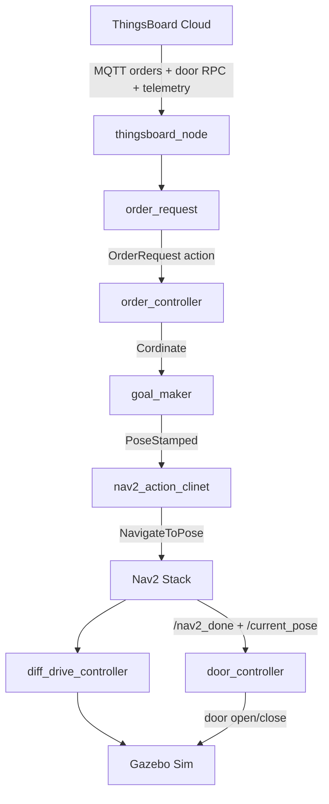
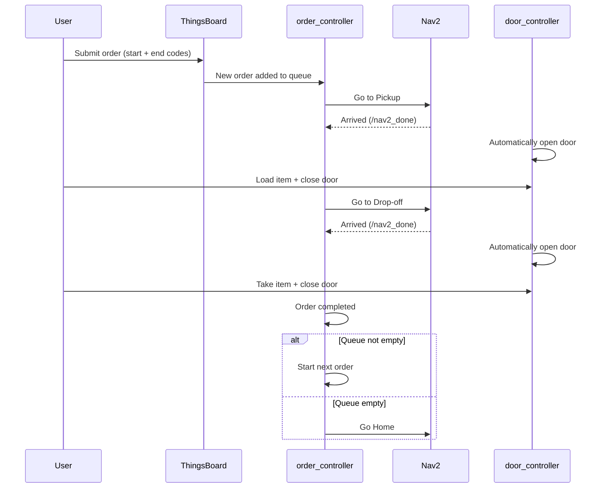
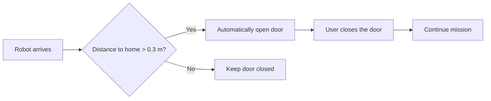

# DeliverBot — Autonomous Warehouse Delivery Robot

<p align="center">
  <strong>Nav2 + ros2_control + Gazebo Sim + ThingsBoard IoT</strong><br>
  A simulation-first ROS 2 system for multi-order warehouse delivery with cloud integration.
</p>

<p align="center">
  
  
  
  
  
</p>

> [!IMPORTANT]
> **DeliverBot is a stable, ready-to-use delivery system in simulation.**  
> It is designed as a clear physical idea of how autonomous delivery should work:  
> the user orders the robot to a pickup point, loads the item, closes the door,  
> and the robot delivers it to the destination. Multiple orders can be queued and are executed one by one.

---

## Project Philosophy

This robot is **not** an industrial product.  
It is a practical demonstration of the basic idea of delivery:

1. You tell the robot where to pick up the item (by typing the coordinate code of the location on the map).
2. The robot goes there and automatically opens the door.
3. You put the item inside and close the door (best practice: a physical button on the robot).
4. You tell the robot the drop-off location (again by coordinate code).
5. The robot delivers the item, opens the door, and waits for you to take it and close the door.
6. If there are more orders in the queue, it continues. If the queue is empty, it returns home.

Using pre-calculated coordinate codes on a known map is heavier to prepare, but it is much more robust, stable and reliable than trying to detect locations dynamically.

The door opens automatically when the robot arrives at a location (except home).  
Closing the door is intentionally left to the user so the experience feels comfortable and under human control.  
In a real deployment the close button should be a physical button on the robot.  
The IoT close button is kept only for demonstration purposes.

---

## Key Features

- **Fleet-ready architecture** – The system can accept multiple orders at the same time. All orders are placed in a queue and executed one by one (FIFO). This design is ready to be extended to a multi-robot fleet.
- Sequential multi-order execution
- Automatic door opening at pickup and drop-off points
- User-controlled door closing (for comfort)
- Return to home when the queue is empty
- Live position telemetry to ThingsBoard
- Remote order submission from the cloud
- Fully working in Gazebo Sim with Nav2 and ros2_control

---

## System Architecture



---

## Packages

| Package                  | Description                                      |
|--------------------------|--------------------------------------------------|
| `deliverbot_msgs`        | Custom messages and the OrderRequest action      |
| `deliverbot_description` | Robot URDF/Xacro, meshes and RViz config         |
| `deliverbot_bringup`     | Launch files, Nav2 parameters, controller config, maps |
| `deliverbot_control`     | Order logic, goal maker, Nav2 client, door controller |
| `deliverbot_cloud`       | ThingsBoard MQTT bridge                          |

---

## Robot Model

- Differential-drive mobile base
- Cargo hatch controlled by a position controller (`Nema_controller`)
- 2D LiDAR (`/scan`)
- Standard ROS 2 TF tree: `map → odom → base_footprint → base_link → ...`

---

## How an Order Works



1. An order arrives from ThingsBoard (or is published manually) with a start and end location code (`red`, `blue`, `yellow`, `green`).
2. The order is placed in the queue.
3. When it is the order’s turn:
   - Robot navigates to the **pickup** location.
   - Door opens automatically.
   - User loads the item and closes the door.
   - Robot navigates to the **drop-off** location.
   - Door opens automatically.
   - User takes the item and closes the door.
   - Order is marked as completed.
4. If more orders exist in the queue → next order starts.
5. If the queue is empty → robot returns to home `(0, 0)`.

This simple and predictable behaviour is intentional. It makes the system reliable and easy to understand.

---

## Door Behaviour



- The door **opens automatically** when the robot arrives at any location except home.
- The door is **closed by the user**.
- Best practice for a real robot: use a physical button on the robot itself.
- The IoT “close door” button is provided only for demonstration and testing.

---

## ThingsBoard Integration

| Direction     | Mechanism                              | Purpose                          |
|---------------|----------------------------------------|----------------------------------|
| Cloud → Robot | Shared Attributes (`pickup`, `placeoff`) | Submit a new delivery order    |
| Cloud → Robot | RPC method `setDoor`                   | Open / close door (demo only)    |
| Robot → Cloud | Telemetry `xPos`, `yPos`               | Live robot position on the map   |

---

## Main Topics & Actions

**Important Topics**

| Topic              | Type                          | Description                     |
|--------------------|-------------------------------|---------------------------------|
| `/order_req`       | `deliverbot_msgs/OrderReq`    | Incoming order from cloud       |
| `/create_goal`     | `deliverbot_msgs/Cordinate`   | Internal goal request           |
| `/send_goal`       | `geometry_msgs/PoseStamped`   | Goal sent to Nav2 client        |
| `/current_pose`    | `geometry_msgs/PoseStamped`  | Current robot pose              |
| `/nav2_done`       | `std_msgs/Bool`               | Navigation finished             |
| `/door_command`    | `std_msgs/Bool`               | Door command (cloud or system)  |
| `/door_feedback`   | `std_msgs/Bool`               | Current door state              |
| `/opendoor`        | `std_msgs/Float64MultiArray`  | Low-level door actuator command |

**Actions**

| Action              | Type                                   | Description                |
|---------------------|----------------------------------------|----------------------------|
| `/order_request`    | `deliverbot_msgs/action/OrderRequest`  | Full delivery order        |
| `/navigate_to_pose` | `nav2_msgs/action/NavigateToPose`      | Nav2 navigation            |

---

## Installation & Build

```bash
mkdir -p ~/deliverbot_ws/src
cd ~/deliverbot_ws/src
# place the five packages here

cd ~/deliverbot_ws
rosdep update
rosdep install --from-paths src --ignore-src -r -y

source /opt/ros/jazzy/setup.bash
colcon build --symlink-install
source install/setup.bash
```

---

## Running the System

```bash
ros2 launch deliverbot_bringup deliverybot.launch.xml
```

---

## Quick Test Commands

```bash
# Send a test order
ros2 topic pub --once /order_req deliverbot_msgs/msg/OrderReq \
"{start: 'red', end: 'blue'}"

# Close the door (demo)
ros2 topic pub --once /door_command std_msgs/msg/Bool "{data: false}"
```

---

## Recording a Demo

```bash
ros2 bag record \
  /tf /tf_static /odom /scan /cmd_vel \
  /current_pose /nav2_done \
  /create_goal /send_goal \
  /door_feedback /door_command /opendoor \
  /order_req /joint_states \
  /robot_description /map \
  /global_costmap/costmap /global_costmap/costmap_updates \
  /plan /plan_smoothed /local_plan \
  -o deliverbot_demo
```

Play later with:

```bash
ros2 bag play deliverbot_demo --clock
```

---

## Current Status

This version is **stable and ready to be used** for demonstration and further development.

### Working
- Multi-order queue (fleet-ready design)
- Sequential execution of orders
- Automatic door opening
- User-controlled door closing
- Return to home when idle
- ThingsBoard order reception and live telemetry
- Full Nav2 navigation in Gazebo Sim

### Design Notes
- Coordinate-based locations (pre-calculated) → more preparation work, but higher reliability
- Physical close button is the recommended real-world solution
- IoT door control is kept only for demonstration

---

## Roadmap

- Physical button interface for door closing
- Better recovery behaviours
- Battery and status telemetry
- Real robot hardware interface
- Multi-robot fleet coordination
- Improved web dashboard

---

## License

TODO — add a proper license before making the repository public.

---

**DeliverBot** shows a complete and understandable delivery loop:

**Order → Queue → Go to Pickup → Open Door → User Closes Door → Go to Drop-off → Open Door → User Closes Door → Next Order or Home**

The system is intentionally simple, predictable and robust — exactly what a first real delivery robot idea should be.